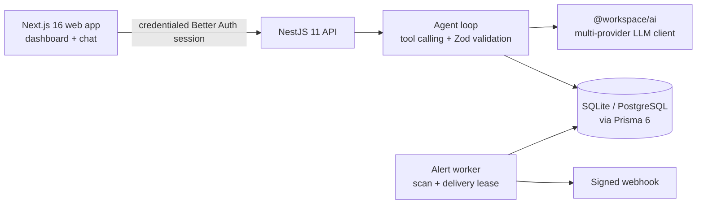

<!-- prettier-ignore -->
<div align="center">


# Aya

**AI-powered staff augmentation agent for resource managers**

[](https://github.com/leodyversemilla07/aya/actions/workflows/ci.yml)

[](https://pnpm.io)
[](https://www.typescriptlang.org)
[](https://nestjs.com)
[](https://nextjs.org)

[Features](#features) · [Architecture](#architecture) · [Quick start](#quick-start) · [Configuration](#configuration) · [API](#api) · [Agent capabilities](#agent-capabilities) · [Background alerts](#background-alerts) · [Scripts](#scripts)

</div>

> Aya helps managers find available developers, match skills to projects, track utilization,
> monitor contracts, and flag risks through natural language conversation.

Aya is a full-stack reference application that pairs a conversational AI agent with live staffing
data. Instead of building dashboards and filters by hand, managers ask questions in plain English
and the agent reasons over the database using tool calling. The result is an assistant that can
answer questions like _"Who is on the bench with React experience?"_, _"Find three senior Node.js
developers for a fintech project starting next month"_, or _"Which contracts expire in the next 30
days?"_ — and return ranked, explainable answers.

## Features

- **Natural-language roster search** — filter developers by canonical skills (all listed skills
  must match), availability, seniority, or current client, with bench status included.
- **Explainable talent matching** — rank best-fit developers for a project by skill level,
  availability, industry experience, seniority, and performance, returning matched and missing
  skills plus scoring reasons.
- **Utilization tracking** — team capacity, active vs bench ratio, and breakdowns by client and
  seniority.
- **Contract management** — status, billing rates, and days until expiry, filterable by client and
  expiry window.
- **Performance monitoring** — velocity, PR merge time, code quality, and client rating per
  developer or team.
- **Proactive risk alerts** — surfaces bench time over 14 days, contracts expiring within 30 days
  (or recently expired), and performance concerns, ranked by severity.
- **Capacity forecasting** — projects weekly bench supply against contract openings for a chosen
  horizon (4–26 weeks) and recommends ranked, explainable backfill candidates per opening.
- **Durable background alerts** — a leased worker detects, deduplicates, resolves, and reopens alerts,
  then sends signed webhook events with observable retry history.
- **In-app alert inbox** — workspace notifications provide a bell badge, unread filtering, and
  per-user read state without changing the underlying alert lifecycle.
- **Prometheus metrics** — token-protected metrics expose worker lag, scan duration, alert
  transitions, webhook attempts, and notification counts.
- **Multi-turn conversations** — history is persisted in the database, streamed token by token, and
  shared across the dashboard and chat pages. Older messages load on demand and chats can be deleted.
- **Native provider streaming** — OpenAI-compatible, Anthropic, and Google providers all stream
  incremental tokens, tool calls, and usage through one provider-neutral contract.
- **Management console** — create, edit, and delete developers, clients, contracts, assignments,
  and performance records from dedicated pages, with search and status filters.
- **Role-based access control** — admin, manager, and viewer roles protect management writes and
  administrative endpoints while preserving read-only access to staffing data.
- **Audit history** — management and role changes record the actor, action, entity, request ID, and
  before/after state in a searchable administrator log.
- **Agent evaluation harness** — deterministic replay benchmarks verify tool routing, arguments,
  grounding, error handling, token usage, and latency without calling a provider in CI.
- **Secure by default** — Better Auth sessions for the browser, API-key compatibility for internal
  clients, credentialed CORS, Helmet, sanitized provider errors, and per-IP rate limiting.

## Architecture



| Workspace | Description |
|-----------|-------------|
| `apps/api` | NestJS 11 backend — agent loop, LLM tool calling, auth, Prisma ORM |
| `apps/web` | Next.js 16 frontend — dashboard and chat UI |
| `packages/ai` | Unified multi-provider LLM client and provider registry |
| `packages/auth` | Shared Better Auth configuration and session handlers |
| `packages/db` | Shared Prisma schema, SQLite/PostgreSQL migrations, and seed data |
| `packages/env` | Runtime-validated server and web environment configuration |
| `packages/ui` | shadcn/ui component library |
| `packages/typescript-config` | Shared TypeScript configuration |

Users sign in through Better Auth at `/sign-in` or `/sign-up`. Sessions are stored in the shared
Prisma database and held in secure HttpOnly cookies. The browser calls the NestJS API directly
using `NEXT_PUBLIC_API_URL` with credentials included; the API validates the session, workspace
role, and CORS origin. The Next.js app has no `app/api` routes — authentication and application
endpoints are both served by NestJS.

The first account in a new local workspace becomes the bootstrap administrator. In production,
only email addresses listed in `ADMIN_EMAILS` may self-register as administrators; all other
self-service accounts start as viewers. An administrator can promote users to manager or viewer
roles. API keys remain trusted internal-client credentials with the same broad access they had
before role enforcement.

API-key authentication is intended for trusted internal clients. Each configured API key has its
own conversation and quota scope. Use Better Auth sessions when conversations must be isolated per
human user.

> [!NOTE]
> A production deployment should place the web app behind an identity-aware gateway for enterprise
> SSO and per-user rate limiting. Better Auth sessions provide the application-level user identity.

## Tech stack

| Layer | Technology |
|-------|------------|
| Backend | NestJS 11, Prisma 6, SQLite (development/tests) or PostgreSQL (production) |
| Frontend | Next.js 16, React 19, shadcn/ui (Base UI), Tailwind CSS, react-markdown |
| LLM | Shared `@workspace/ai` package (OpenAI, OpenRouter, OpenCode Zen, Anthropic, Google Gemini, custom OpenAI-compatible) |
| Validation | Zod 4 |
| Auth | Better Auth email/password sessions + API-key compatibility |
| Tooling | Biome (lint + format), Jest (API), Vitest + RTL (web), Playwright (browser E2E), Turborepo, pnpm 12.16 |
| CI | GitHub Actions on Node.js 24 |

## Quick start

Requires **Node.js 24.15+** and **pnpm 12.16+**. The exact pnpm version is pinned in `package.json`.

```bash
# 1. Install dependencies (also generates the Prisma client)
pnpm install

# 2. Configure environment
cp .env.example .env
# Set BETTER_AUTH_SECRET, API_KEY, and LLM_API_KEY at minimum.

# 3. Create and seed the SQLite database
pnpm run db:push
pnpm run db:seed

# 4. Run API (http://localhost:3001) and web (http://localhost:3000)
pnpm run dev
```

Then open http://localhost:3000, create an account, and start chatting with Aya. The API health
check is available at http://localhost:3001/health.

The SQLite file lives at `packages/db/prisma/dev.db` when `DATABASE_URL="file:./dev.db"`.
For a migration-based workflow instead of `db:push`:

```bash
pnpm run db:migrate:deploy   # apply committed migrations
pnpm run db:migrate          # create a migration during development
```

## Production deployment

Use a managed PostgreSQL database and deploy the API and web application as separate Node.js
processes. Set the production environment variables, then install, migrate, and build:

```bash
cp .env.example .env
# Set DATABASE_URL, API_KEY, BETTER_AUTH_SECRET, and LLM_API_KEY.
pnpm install
pnpm run db:migrate:deploy
pnpm run build
```

Start `pnpm --filter @aya/api run start:prod` and `pnpm --filter web run start` on your deployment
platform. Run `pnpm run worker:alerts:prod` as a separate process to enable proactive alert scans
and webhook delivery. See [docs/DEPLOYMENT.md](docs/DEPLOYMENT.md) for the PostgreSQL migration
workflow, health checks, quotas, logging, and reverse-proxy guidance.

## Configuration

All configuration lives in a single root `.env` file, loaded by the API, the web build, the Prisma
CLI, and the seed process.

```env
DATABASE_URL="file:./dev.db"
NODE_ENV="development"

# Better Auth
BETTER_AUTH_SECRET="replace-with-a-random-32-byte-secret"
BETTER_AUTH_URL="http://localhost:3000"
ADMIN_EMAILS="admin@example.com"

# LLM: openai | openrouter | opencode-zen | anthropic | google | custom
LLM_PROVIDER="opencode-zen"
LLM_API_KEY="your-api-key"
LLM_BASE_URL="https://opencode.ai/zen/v1"
LLM_MODEL="minimax-m2.5-free"
LLM_TIMEOUT_MS="60000"
LLM_MAX_RETRIES="2"
LLM_MAX_TOKENS="4096"
LLM_CONTEXT_WINDOW="128000"
AGENT_TIMEOUT_MS="180000"

# API
API_PORT="3001"
API_KEY="change-me-to-a-long-random-string"
API_KEYS="client-a-secret,client-b-secret"
CORS_ORIGINS="http://localhost:3000"
TRUST_PROXY="false"
CHAT_DAILY_QUOTA="200"

# Background alert worker (set URL and secret together to enable webhooks)
ALERT_SCAN_INTERVAL_MS="60000"
ALERT_LEASE_SECONDS="60"
ALERT_WEBHOOK_URL=""
ALERT_WEBHOOK_SECRET=""
ALERT_WEBHOOK_TIMEOUT_MS="10000"
ALERT_WEBHOOK_MAX_ATTEMPTS="5"
METRICS_TOKEN=""

NEXT_PUBLIC_API_URL="http://localhost:3001"
```

| Variable | Default | Notes |
|----------|---------|-------|
| `DATABASE_URL` | `file:./dev.db` | Relative SQLite paths resolve from `packages/db/prisma`. Use `postgresql://…` for PostgreSQL. |
| `BETTER_AUTH_SECRET` | — | Required in production. Generate with `openssl rand -base64 32`. |
| `BETTER_AUTH_URL` | `http://localhost:3000` | Public URL of the web origin. |
| `ADMIN_EMAILS` | — | Comma-separated emails allowed to self-register as admins in production. |
| `LLM_PROVIDER` | `opencode-zen` | `openai`, `openrouter`, `opencode-zen`, `anthropic`, `google`, or `custom`. |
| `LLM_API_KEY` | — | Provider key. Provider-specific keys (`OPENAI_API_KEY`, etc.) also work. |
| `LLM_BASE_URL` / `LLM_MODEL` | provider default | Override the selected provider's defaults. |
| `LLM_TIMEOUT_MS` | `60000` | Per-request LLM timeout. |
| `LLM_MAX_RETRIES` | `2` | Retries for retryable provider failures. |
| `LLM_MAX_TOKENS` | `4096` | Maximum completion tokens. |
| `LLM_CONTEXT_WINDOW` | `128000` | Context window size used to estimate context usage in the chat UI. |
| `AGENT_TIMEOUT_MS` | `180000` | Total deadline for a single agent turn. |
| `API_PORT` | `3001` | API listen port. |
| `API_KEY` | — | Legacy single internal client key; `API_KEY` or `API_KEYS` is required. |
| `API_KEYS` | — | Optional comma-separated additional internal client keys. |
| `CORS_ORIGINS` | `http://localhost:3000` | Comma-separated allowlist. Do not use `*` with credentials. |
| `TRUST_PROXY` | `false` | Set `true` when a trusted reverse proxy terminates TLS. |
| `CHAT_DAILY_QUOTA` | `200` | Chat requests per user/API key per UTC day. `0` disables quotas. |
| `ALERT_SCAN_INTERVAL_MS` | `60000` | Delay between background alert scans; minimum 5 seconds. |
| `ALERT_LEASE_SECONDS` | `60` | Database worker lease duration; minimum 10 seconds. |
| `ALERT_WEBHOOK_URL` | — | Endpoint for signed alert lifecycle events. Requires `ALERT_WEBHOOK_SECRET`. |
| `ALERT_WEBHOOK_SECRET` | — | HMAC-SHA256 secret, at least 16 characters. Requires `ALERT_WEBHOOK_URL`. |
| `ALERT_WEBHOOK_TIMEOUT_MS` | `10000` | Per-request webhook timeout. |
| `ALERT_WEBHOOK_MAX_ATTEMPTS` | `5` | Maximum attempts for a failed delivery. |
| `METRICS_TOKEN` | — | Optional token for `GET /metrics`; at least 16 characters. The endpoint is disabled when unset. |
| `NEXT_PUBLIC_API_URL` | `http://localhost:3001` | Only browser-exposed value. |
| `SEED_FORCE` | `false` | Allow seeding when `NODE_ENV=production`. |
| `SEED_RESET_CONVERSATIONS` | `false` | Also reset conversations when seeding. |
| `SEED_RESET_USERS` | `false` | Test-only: delete auth users, sessions, and audit history while seeding. |

> [!IMPORTANT]
> `API_KEY` or `API_KEYS` is required in every environment; the API refuses to start without one. Never expose
> API keys, `BETTER_AUTH_SECRET`, or other server secrets to browser code — `NEXT_PUBLIC_API_URL`
> is the only value that should reach the client.

Each configured API key gets its own hashed conversation ownership scope and daily quota subject;
raw keys are never stored. `API_KEYS` may be used instead of or alongside the legacy `API_KEY`.

## API

The machine-readable contract is served as OpenAPI 3.1 at `/openapi.json`, and an interactive
reference (Swagger UI) is available at `/docs`. Both are public; the operations they describe still
require authentication as listed below.

| Endpoint | Method | Auth | Description |
|----------|--------|------|-------------|
| `/` | `GET` | Public | Service greeting |
| `/health` | `GET` | Public | Process liveness check |
| `/ready` | `GET` | Public | Database readiness check |
| `/api/auth/*` | `GET`/`POST` | Public / session | Better Auth sign-in, sign-up, and session endpoints |
| `/stats` | `GET` | Session / API key | Dashboard statistics and alert count |
| `/conversations` | `GET` | Session / API key | User's recent conversations |
| `/conversations/:id` | `GET` | Session / API key | User's conversation messages |
| `/conversations/:id` | `DELETE` | Session / API key | Delete a user's conversation |
| `/agent/chat` | `POST` | Session / API key | Chat with Aya |
| `/agent/chat/stream` | `POST` | Session / API key | Stream a chat response over Server-Sent Events |
| `/developers` | `GET`/`POST` | Session / API key | List or create developers |
| `/developers/:id` | `GET`/`PATCH`/`DELETE` | Session / API key | Read, update, or delete a developer |
| `/clients` | `GET`/`POST` | Session / API key | List or create clients |
| `/clients/:id` | `GET`/`PATCH`/`DELETE` | Session / API key | Read, update, or delete a client |
| `/contracts` | `GET`/`POST` | Session / API key | List or create contracts |
| `/contracts/:id` | `GET`/`PATCH`/`DELETE` | Session / API key | Read, update, or delete a contract |
| `/assignments` | `GET`/`POST` | Session / API key | List or create assignments |
| `/assignments/:id` | `GET`/`PATCH`/`DELETE` | Session / API key | Read, update, or delete an assignment |
| `/performance` | `GET`/`POST` | Session / API key | List or create performance records |
| `/performance/:id` | `GET`/`PATCH`/`DELETE` | Session / API key | Read, update, or delete a performance record |
| `/admin/users` | `GET` | Admin | List workspace users and roles |
| `/admin/users/:id/role` | `PATCH` | Admin | Change a workspace user's role |
| `/admin/audit-logs` | `GET` | Admin | Browse mutation and access audit history |
| `/alerts` | `GET` | Session / API key | List persisted staffing alert state |
| `/alerts/deliveries` | `GET` | Admin | Inspect webhook delivery attempts and failures |
| `/admin/alerts/config` | `GET` | Admin | Inspect effective alert rules and delivery configuration |
| `/admin/alerts/scan` | `POST` | Admin | Trigger an immediate, audited alert scan |
| `/notifications` | `GET` | Session | List the signed-in user's notification inbox |
| `/notifications/unread-count` | `GET` | Session | Get the signed-in user's unread count |
| `/notifications/:id/read` | `POST` | Session | Mark one notification as read |
| `/notifications/read-all` | `POST` | Session | Mark all notifications as read |
| `/forecast` | `GET` | Session / API key | Capacity forecast with openings, bench pool, and backfill recommendations |
| `/metrics` | `GET` | Metrics token | Prometheus exposition for alert operations |

### Chat request

```ts
// POST /agent/chat
{ message: string; conversationId?: string }

// Response
{ conversationId: string; content: string }
```

`message` is trimmed, non-empty, and capped at 10,000 characters. Invalid bodies return `400`,
unknown conversation IDs return `404`. Conversation history is bounded and supports cursor
pagination with `?limit=100&before=<message-id>`.

Every chat request consumes one unit of the caller's daily quota. Responses include
`x-chat-quota-limit`, `x-chat-quota-used`, `x-chat-quota-remaining`, and `x-chat-quota-reset`
(ISO-8601 UTC). Once the limit is reached, the API returns `429` with `retry-after` and the quota
headers set in `.env.example`; see [Production deployment](docs/DEPLOYMENT.md).

Every response includes `x-request-id`. Callers may supply their own in the same header when it is
8–128 characters of `A-Z`, `a-z`, `0-9`, `.`, `_`, `:`, or `-`; otherwise the API generates a UUID.
Error bodies include the same `requestId`, and the API writes one JSON completion line per request
to stdout.

### Streaming chat

`POST /agent/chat/stream` accepts the same body as `/agent/chat` and responds with
`text/event-stream`. Each event carries JSON data:

| Event | Data | Meaning |
|-------|------|---------|
| `conversation` | `{ id, title }` | Conversation created or resumed |
| `status` | `{ message }` | Friendly progress text while tools run |
| `delta` | `{ content }` | Incremental assistant text |
| `done` | `{ conversationId, content }` | Final text, already persisted |
| `error` | `{ message, requestId }` | Safe, user-facing failure message |

Comment heartbeats (`: ping`) are sent every 15 seconds to keep proxies from closing idle
connections. A client disconnect aborts the underlying LLM request. Every provider streams native
tokens: OpenAI-compatible providers use `chat/completions` SSE deltas, Anthropic uses Messages API
content-block events, and Google uses Gemini `streamGenerateContent` chunks.

```bash
curl -N -X POST http://localhost:3001/agent/chat/stream \
  -H 'content-type: application/json' \
  -H 'x-api-key: your-key' \
  -d '{"message":"Who is on the bench?"}'
```

### Management endpoints

The five management resources share the same shape: `GET /<resource>` returns
`{ total, limit, offset, items }`, `POST` creates, `GET/:id` reads, `PATCH/:id` updates, and
`DELETE/:id` deletes. Bodies are validated with Zod and dates use `YYYY-MM-DD`.

| Resource | List filters |
|----------|--------------|
| `developers` | `search`, `seniority`, `skill`, `clientId`, `onBench` |
| `clients` | `search`, `industry` |
| `contracts` | `status`, `clientId`, `developerId`, `expiringWithin` |
| `assignments` | `status`, `clientId`, `developerId`, `active` |
| `performance` | `developerId`, `period` |

All list endpoints accept `limit` (1–200) and `offset`. Updating a developer replaces the submitted
skill list, and updating a client replaces the submitted contact list. Omitting `skills` or `contacts`
from an update leaves the stored list untouched. Unique conflicts return `409`; invalid references and
validation failures return `400`; missing records return `404`.

Read operations are available to admins, managers, and viewers. Creating, updating, or deleting
staffing records requires the admin or manager role; administrative user and audit-log endpoints
require admin access. Trusted API-key clients bypass role checks.

Text filters ignore case on both SQLite and PostgreSQL. SQLite's `LIKE` is already case-insensitive
while PostgreSQL needs `ILIKE`, so the API builds the filter for the database in use and both
databases return the same rows.

Two rules keep the management console and the agent in agreement:

- **Skills are canonical.** The agent matches skills by canonical name, so `Node.js`, `node js`, and
  `NodeJS` are the same skill. A request that lists the same skill twice — even with different
  punctuation or spacing — is rejected with `400` instead of storing duplicate rows.
- **Bench state follows the assignment lifecycle.** `benchSince` marks the start of a developer's
  current bench period, so it is cleared when a developer is assigned and set when they are released.
  The dashboard, the roster tool, and the risk alerts all read it, so it is reconciled whenever
  assignments are created, updated, or deleted. Setting a bench start date for a developer who holds
  an assignment returns `400`.

An expiry window (`expiringWithin`) only covers contracts that have already started, so a contract
that begins next month is never reported as expiring this month. The dashboard and the risk alerts
use the same rule.

### Authentication and authorization

- Browser requests use credentialed Better Auth session cookies, scoped to the signed-in user.
- **Admin** users have full access, including workspace role management and audit history.
- **Manager** users can use Aya and create, update, or delete staffing records.
- **Viewer** users have read-only access to dashboard and management data and can query Aya.
- The first account in an empty local workspace bootstraps the admin role. In production, only
  allowlisted `ADMIN_EMAILS` can self-register as admins; later accounts are viewers.
- Internal clients may send `x-api-key: <key>` or `Authorization: Bearer <key>` and are treated as
  trusted, fully authorized workspace clients.
- `/`, `/health`, and `/ready` are public.
- `/agent/chat` and `/agent/chat/stream` are rate limited to 20 requests/minute per API client IP
  by default, and limited by `CHAT_DAILY_QUOTA` per user/API key per UTC day.
- `x-request-id` is echoed or generated on every response; JSON failures include `requestId`.
- In production, request completion and failure lines are emitted as structured JSON.

Provider errors are mapped to safe, actionable responses: authentication failures return `502`
(check `LLM_API_KEY`), `429` means the provider rate limit was reached, timeouts return `504`, and
network failures return `502`.

## Agent capabilities

Aya can call seven tools autonomously:

| Tool | What it does |
|------|--------------|
| `query_roster` | Search developers by skills, availability, seniority, or client |
| `match_developers` | Rank best-fit developers for a project requirement |
| `get_utilization` | Team utilization metrics (active vs bench) |
| `check_contracts` | Contract status, billing rates, and upcoming renewals |
| `get_performance` | Developer or team performance data |
| `get_alerts` | Proactive risk alerts (bench time, expiring contracts, performance) |
| `forecast_capacity` | Weekly capacity forecast with ranked backfill recommendations for an 8-week (or 1–26 week) horizon |

`get_alerts` and the background worker use the same alert query service, so chat answers and
proactive detection follow one set of rules. See
[Background alerts](docs/BACKGROUND_ALERTS.md) for lifecycle, webhook, and worker operations.

```
User query → LLM reasoning → tool call → Zod validation → database query → formatted response
```

Tool arguments are validated with Zod before execution, and multi-turn history is persisted in the
database. To keep turns bounded and predictable, tool iterations and provider completions are capped;
if a cap is reached the agent is asked for a final answer using the results already gathered. Each
turn has a total deadline and is cancelled if the client disconnects, and only the most recent 20
user/assistant messages (up to 40,000 characters) are replayed to the model. Tool calls and results
are stored for auditability. The system prompt includes today's date so expiry reasoning is
deterministic.

### Background alerts

The alert worker evaluates the same rules as the `get_alerts` tool, persists one lifecycle row per
condition, and sends optional signed webhook events. It uses a database lease so concurrent workers
skip an active iteration and atomic delivery claims so one event is not sent concurrently. Resolved
alerts remain visible and reopen with a new event if the condition returns.

Each transition also creates an in-app notification. Workspace users can review the inbox, filter
unread items, and persist per-user read state. When `METRICS_TOKEN` is configured, `GET /metrics`
exposes worker lag, scan duration, lifecycle transitions, delivery attempts, and inbox counts in
Prometheus format.

```bash
pnpm run worker:alerts:once  # one scan and delivery iteration
pnpm run worker:alerts        # continuous development worker
```

See [Background alerts](docs/BACKGROUND_ALERTS.md) for detection rules, webhook payloads, signature
verification, retries, and deployment guidance.

### Agent evaluations

The agent evaluation harness runs 12 realistic scenarios against the real agent loop, tool router,
schemas, and seeded database. Replay mode is deterministic and provider-free, so it can block
orchestration and data-grounding regressions in CI. Live mode runs the same assertions against the
configured provider to detect prompt, tool-description, and model regressions.

```bash
pnpm run agent:eval       # deterministic replay benchmark
pnpm run agent:eval:live  # same scenarios against the configured provider
```

See [Agent evaluations](docs/AGENT_EVALUATIONS.md) for scenario coverage, metrics, reports, and
instructions for adding new cases.

## Database

Prisma 6 targets SQLite for local development and tests, and PostgreSQL for production. The
Prisma schema and `DATABASE_URL` select the schema and migration directory automatically; the
generated `packages/db/prisma/schema.postgresql.prisma` is checked in and verified in CI.

Core models: **Developer**, **Skill**, **Client**, **Contact**, **Assignment**, **Contract**,
**Performance**, **Conversation**, **Message**, **ChatUsage**, **AuditLog**, **StaffingAlert**,
**AlertDelivery**, **Notification**, **NotificationRead**, and **WorkerLease**, plus Better Auth
**User**, **Session**, and **Account** tables. The user model carries the workspace role, and audit
entries preserve the actor snapshot even if the acting user is later removed. Indexes cover common
filters such as developer name/seniority/bench, skill name, client industry, assignment and contract
status/end dates, performance period, conversation/message ordering, audit actor/entity lookups, and
daily quota lookups.

The seed script creates a deterministic dataset relative to today's date: 6 clients, 12 developers,
50 skills, 11 assignments, 11 contracts, and 11 performance records — including a developer on the
bench for 45 days and contracts expiring in 5, 10, and 25 days. Business data resets on every seed;
conversations are preserved unless `SEED_RESET_CONVERSATIONS=true`. The test-only
`SEED_RESET_USERS=true` switch also deletes auth users, sessions, and audit history, so it should
only be used with a disposable database. Production seeding requires `SEED_FORCE=true`.

```bash
pnpm run db:seed      # seed demo data
pnpm run db:studio    # browse data in Prisma Studio
```

## Scripts

| Script | Description |
|--------|-------------|
| `pnpm run dev` | Start all apps in development mode |
| `pnpm run build` | Production build for all workspaces |
| `pnpm run lint` | Check with Biome |
| `pnpm run lint:fix` | Apply safe and unsafe Biome fixes |
| `pnpm run format` | Format with Biome |
| `pnpm run typecheck` | TypeScript type checking |
| `pnpm run test` | API unit tests (Jest) and web unit/component tests (Vitest) |
| `pnpm run test:e2e` | API end-to-end and tool integration tests |
| `pnpm run test:e2e:web` | Playwright browser tests against the production build |
| `pnpm run agent:eval` | Run deterministic agent evaluation scenarios |
| `pnpm run agent:eval:live` | Run agent evaluations against the configured LLM provider |
| `pnpm run worker:alerts` | Run the background alert worker in development |
| `pnpm run worker:alerts:once` | Run one background alert scan and delivery iteration |
| `pnpm run worker:alerts:prod` | Run the compiled background alert worker |
| `pnpm run worker:alerts:prod:once` | Run one compiled alert scan and delivery iteration |
| `pnpm run audit` | Audit production dependencies |
| `pnpm run audit:all` | Audit all dependencies, including tooling |
| `pnpm run db:generate` | Generate the Prisma client |
| `pnpm run db:push` | Push the Prisma schema to the local database |
| `pnpm run db:migrate` | Create a development migration |
| `pnpm run db:migrate:deploy` | Apply committed migrations (SQLite or PostgreSQL) |
| `pnpm run db:drift` | Verify committed SQLite migrations match the Prisma schema |
| `pnpm run db:postgres:sync` | Regenerate the PostgreSQL schema from the SQLite schema |
| `pnpm run db:postgres:check` | Fail if the generated PostgreSQL schema is stale |
| `pnpm run db:seed` | Seed demo data |
| `pnpm run db:studio` | Open Prisma Studio |

## Testing

```bash
pnpm run test          # API unit tests (Jest) + web unit/component tests (Vitest)
pnpm run test:e2e      # API e2e tests (Jest + Supertest)
pnpm run test:e2e:web  # browser e2e tests (Playwright)
pnpm run agent:eval    # deterministic agent behavior benchmark
```

The web app uses **Vitest** with React Testing Library and jsdom for unit and component tests.
`pnpm run test:e2e:web` builds the workspace and then runs **Playwright** against the production
build. Playwright starts the API and web servers itself, seeds `packages/db/prisma/playwright.db`,
and covers sign-up/sign-in, session redirects, dashboard data, chat rendering, chat errors, the
notification inbox and read state, and management console CRUD. The
LLM is mocked in the browser, so no provider calls are made. Install the browser once with:

```bash
pnpm --filter web exec playwright install chromium
```

The API e2e suite uses `file:./test-e2e.db` (`packages/db/prisma/test-e2e.db`) and applies the committed
migrations automatically, so no manual database setup is required. Tests do not call a real LLM —
they cover public health/readiness routes, request validation, API-key enforcement, a mocked agent
tool-call loop, bounded conversation pagination, canonical skill matching, staffing-state rules,
ambiguous client names, role enforcement, administration, audit history, background alert lifecycle,
in-app notification read state, signed webhook retries, worker leases, Prometheus metrics, and
management CRUD
(validation, unique conflicts, cascade deletes, skill canonicalization, and bench-state
reconciliation).

The agent evaluation benchmark uses its own disposable
`packages/db/prisma/agent-eval.db` database. Replay mode verifies tool routing, argument validity,
grounding, response content, empty results, and safe error handling without provider credentials or
network access. Live mode uses the configured provider and reports the same metrics plus token usage
and latency.

CI runs audit, migration drift checks, lint, typecheck, unit tests, the deterministic agent
evaluation benchmark, SQLite and PostgreSQL-backed API e2e tests, background worker smoke tests,
Playwright browser tests, and the production build on Node.js 24 with pnpm 12.16.
The PostgreSQL job also verifies migrations and schema drift against a clean database.

## LLM providers

| Provider | Default base URL | Default model | Streaming |
|----------|------------------|---------------|-----------|
| `opencode-zen` | `https://opencode.ai/zen/v1` | `minimax-m2.5-free` | Native SSE |
| `openai` | `https://api.openai.com/v1` | `gpt-4o-mini` | Native SSE |
| `openrouter` | `https://openrouter.ai/api/v1` | `google/gemma-4-26b-a4b-it:free` | Native SSE |
| `anthropic` | `https://api.anthropic.com` | `claude-sonnet-4-5` | Native Messages API SSE |
| `google` | `https://generativelanguage.googleapis.com/v1beta` | `gemini-2.5-flash` | Native Gemini SSE |
| `custom` | `http://localhost:3000/v1` | `default` | Native SSE |

Set `LLM_PROVIDER` and `LLM_API_KEY` to switch providers, or override `LLM_BASE_URL` and
`LLM_MODEL`. Provider factories are also exported from `@workspace/ai/providers/*` when an
application needs more than the environment-selected provider. See
[LLM providers](docs/LLM_PROVIDERS.md) for streaming, tool-call, and usage details per provider.

## Deployment

- Set `NODE_ENV=production` and strong `API_KEY` / `BETTER_AUTH_SECRET` values.
- Set `ADMIN_EMAILS` to the comma-separated addresses allowed to self-register as administrators.
- Set `CORS_ORIGINS` to the deployed web origin(s) and enable credentialed CORS.
- Use PostgreSQL in production and apply migrations with `pnpm run db:migrate:deploy` before starting
  the API. `DATABASE_URL` selects the SQLite or PostgreSQL schema and migrations automatically.
- Run `pnpm run build`; Turborepo compiles `@workspace/db` to `packages/db/dist` so the API runs on
  Node.js without a TypeScript loader.
- The web app reads `NEXT_PUBLIC_API_URL` at build time for direct browser API calls.
- Run `pnpm run worker:alerts:prod` as a separate process when proactive scans or webhook delivery
  are required. Multiple workers coordinate through a PostgreSQL lease.

See [Production deployment](docs/DEPLOYMENT.md) for PostgreSQL setup, quotas, structured logging,
SSE proxy settings, and the migration workflow.

> [!NOTE]
> SQLite remains the default for local development and tests. Production deployments should use
> PostgreSQL when running more than one API instance.

## Documentation

- [Development setup](docs/DEVELOPMENT_SETUP.md) — local environment, testing, and troubleshooting
- [Agent evaluations](docs/AGENT_EVALUATIONS.md) — benchmark modes, metrics, scenarios, and reports
- [Background alerts](docs/BACKGROUND_ALERTS.md) — alert rules, worker operation, and signed webhooks
- [LLM providers](docs/LLM_PROVIDERS.md) — provider selection, native streaming, and tool semantics
- [Project specification](docs/SPEC.md) — features, architecture, data model, and success criteria
- [Brand guide](docs/BRAND.md) — logo variants, color, typography, and usage rules
