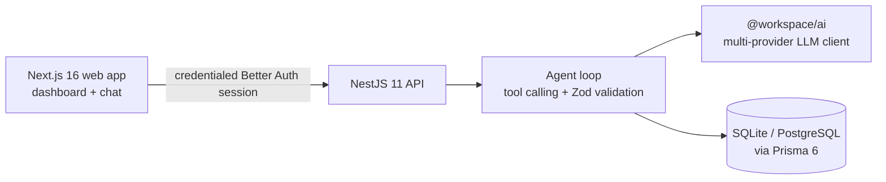

<!-- prettier-ignore -->
<div align="center">


# Aya

**AI-powered staff augmentation agent for resource managers**

[](https://github.com/leodyversemilla07/aya/actions/workflows/ci.yml)

[](https://pnpm.io)
[](https://www.typescriptlang.org)
[](https://nestjs.com)
[](https://nextjs.org)

[Features](#features) · [Architecture](#architecture) · [Quick start](#quick-start) · [Configuration](#configuration) · [API](#api) · [Agent capabilities](#agent-capabilities) · [Scripts](#scripts)

</div>

> Aya helps managers find available developers, match skills to projects, track utilization,
> monitor contracts, and flag risks through natural language conversation.

Aya is a full-stack reference application that pairs a conversational AI agent with live staffing
data. Instead of building dashboards and filters by hand, managers ask questions in plain English
and the agent reasons over the database using tool calling. The result is an assistant that can
answer questions like _"Who is on the bench with React experience?"_, _"Find three senior Node.js
developers for a fintech project starting next month"_, or _"Which contracts expire in the next 30
days?"_ — and return ranked, explainable answers.

## Features

- **Natural-language roster search** — filter developers by canonical skills (all listed skills
  must match), availability, seniority, or current client, with bench status included.
- **Explainable talent matching** — rank best-fit developers for a project by skill level,
  availability, industry experience, seniority, and performance, returning matched and missing
  skills plus scoring reasons.
- **Utilization tracking** — team capacity, active vs bench ratio, and breakdowns by client and
  seniority.
- **Contract management** — status, billing rates, and days until expiry, filterable by client and
  expiry window.
- **Performance monitoring** — velocity, PR merge time, code quality, and client rating per
  developer or team.
- **Proactive risk alerts** — surfaces bench time over 14 days, contracts expiring within 30 days
  (or recently expired), and performance concerns, ranked by severity.
- **Multi-turn conversations** — history is persisted in the database, streamed token by token, and
  shared across the dashboard and chat pages. Older messages load on demand and chats can be deleted.
- **Management console** — create, edit, and delete developers, clients, contracts, assignments,
  and performance records from dedicated pages, with search and status filters.
- **Secure by default** — Better Auth sessions for the browser, API-key compatibility for internal
  clients, credentialed CORS, Helmet, sanitized provider errors, and per-IP rate limiting.

## Architecture



| Workspace | Description |
|-----------|-------------|
| `apps/api` | NestJS 11 backend — agent loop, LLM tool calling, auth, Prisma ORM |
| `apps/web` | Next.js 16 frontend — dashboard and chat UI |
| `packages/ai` | Unified multi-provider LLM client and provider registry |
| `packages/auth` | Shared Better Auth configuration and session handlers |
| `packages/db` | Shared Prisma schema, SQLite/PostgreSQL migrations, and seed data |
| `packages/env` | Runtime-validated server and web environment configuration |
| `packages/ui` | shadcn/ui component library |
| `packages/typescript-config` | Shared TypeScript configuration |

Users sign in through Better Auth at `/sign-in` or `/sign-up`. Sessions are stored in the shared
Prisma database and held in secure HttpOnly cookies. The browser calls the NestJS API directly
using `NEXT_PUBLIC_API_URL` with credentials included; the API validates the session and CORS
origin. The Next.js app has no `app/api` routes — authentication and application endpoints are both
served by NestJS.

> [!NOTE]
> A production deployment should place the web app behind an identity-aware gateway for enterprise
> SSO and per-user rate limiting. Better Auth sessions provide the application-level user identity.

## Tech stack

| Layer | Technology |
|-------|------------|
| Backend | NestJS 11, Prisma 6, SQLite (development/tests) or PostgreSQL (production) |
| Frontend | Next.js 16, React 19, shadcn/ui, Tailwind CSS, react-markdown |
| LLM | Shared `@workspace/ai` package (OpenAI, OpenRouter, OpenCode Zen, Anthropic, Google Gemini, custom OpenAI-compatible) |
| Validation | Zod 4 |
| Auth | Better Auth email/password sessions + API-key compatibility |
| Tooling | Biome (lint + format), Jest (API), Vitest + RTL (web), Playwright (browser E2E), Turborepo, pnpm 12.16 |
| CI | GitHub Actions on Node.js 24 |

## Quick start

Requires **Node.js 24.15+** and **pnpm 12.16+**. The exact pnpm version is pinned in `package.json`.

```bash
# 1. Install dependencies (also generates the Prisma client)
pnpm install

# 2. Configure environment
cp .env.example .env
# Set BETTER_AUTH_SECRET, API_KEY, and LLM_API_KEY at minimum.

# 3. Create and seed the SQLite database
pnpm run db:push
pnpm run db:seed

# 4. Run API (http://localhost:3001) and web (http://localhost:3000)
pnpm run dev
```

Then open http://localhost:3000, create an account, and start chatting with Aya. The API health
check is available at http://localhost:3001/health.

The SQLite file lives at `packages/db/prisma/dev.db` when `DATABASE_URL="file:./dev.db"`.
For a migration-based workflow instead of `db:push`:

```bash
pnpm run db:migrate:deploy   # apply committed migrations
pnpm run db:migrate          # create a migration during development
```

## Production deployment

Use a managed PostgreSQL database and deploy the API and web application as separate Node.js
processes. Set the production environment variables, then install, migrate, and build:

```bash
cp .env.example .env
# Set DATABASE_URL, API_KEY, BETTER_AUTH_SECRET, and LLM_API_KEY.
pnpm install
pnpm run db:migrate:deploy
pnpm run build
```

Start `pnpm --filter @aya/api run start:prod` and `pnpm --filter web run start` on your deployment
platform. See [docs/DEPLOYMENT.md](docs/DEPLOYMENT.md) for the PostgreSQL migration workflow, health
checks, quotas, logging, and reverse-proxy guidance.

## Configuration

All configuration lives in a single root `.env` file, loaded by the API, the web build, the Prisma
CLI, and the seed process.

```env
DATABASE_URL="file:./dev.db"
NODE_ENV="development"

# Better Auth
BETTER_AUTH_SECRET="replace-with-a-random-32-byte-secret"
BETTER_AUTH_URL="http://localhost:3000"

# LLM: openai | openrouter | opencode-zen | anthropic | google | custom
LLM_PROVIDER="opencode-zen"
LLM_API_KEY="your-api-key"
LLM_BASE_URL="https://opencode.ai/zen/v1"
LLM_MODEL="minimax-m2.5-free"
LLM_TIMEOUT_MS="60000"
LLM_MAX_RETRIES="2"
LLM_MAX_TOKENS="4096"
AGENT_TIMEOUT_MS="180000"

# API
API_PORT="3001"
API_KEY="change-me-to-a-long-random-string"
CORS_ORIGINS="http://localhost:3000"
TRUST_PROXY="false"
CHAT_DAILY_QUOTA="200"
NEXT_PUBLIC_API_URL="http://localhost:3001"
```

| Variable | Default | Notes |
|----------|---------|-------|
| `DATABASE_URL` | `file:./dev.db` | Relative SQLite paths resolve from `packages/db/prisma`. Use `postgresql://…` for PostgreSQL. |
| `BETTER_AUTH_SECRET` | — | Required in production. Generate with `openssl rand -base64 32`. |
| `BETTER_AUTH_URL` | `http://localhost:3000` | Public URL of the web origin. |
| `LLM_PROVIDER` | `opencode-zen` | `openai`, `openrouter`, `opencode-zen`, `anthropic`, `google`, or `custom`. |
| `LLM_API_KEY` | — | Provider key. Provider-specific keys (`OPENAI_API_KEY`, etc.) also work. |
| `LLM_BASE_URL` / `LLM_MODEL` | provider default | Override the selected provider's defaults. |
| `LLM_TIMEOUT_MS` | `60000` | Per-request LLM timeout. |
| `LLM_MAX_RETRIES` | `2` | Retries for retryable provider failures. |
| `LLM_MAX_TOKENS` | `4096` | Maximum completion tokens. |
| `AGENT_TIMEOUT_MS` | `180000` | Total deadline for a single agent turn. |
| `API_PORT` | `3001` | API listen port. |
| `API_KEY` | — | **Required in every environment**; startup fails without it. |
| `CORS_ORIGINS` | `http://localhost:3000` | Comma-separated allowlist. Do not use `*` with credentials. |
| `TRUST_PROXY` | `false` | Set `true` when a trusted reverse proxy terminates TLS. |
| `CHAT_DAILY_QUOTA` | `200` | Chat requests per user/API key per UTC day. `0` disables quotas. |
| `NEXT_PUBLIC_API_URL` | `http://localhost:3001` | Only browser-exposed value. |
| `SEED_FORCE` | `false` | Allow seeding when `NODE_ENV=production`. |
| `SEED_RESET_CONVERSATIONS` | `false` | Also reset conversations when seeding. |

> [!IMPORTANT]
> `API_KEY` is required in every environment; the API refuses to start without it. Never expose
> API keys, `BETTER_AUTH_SECRET`, or other server secrets to browser code — `NEXT_PUBLIC_API_URL`
> is the only value that should reach the client.

## API

| Endpoint | Method | Auth | Description |
|----------|--------|------|-------------|
| `/` | `GET` | Public | Service greeting |
| `/health` | `GET` | Public | Process liveness check |
| `/ready` | `GET` | Public | Database readiness check |
| `/api/auth/*` | `GET`/`POST` | Public / session | Better Auth sign-in, sign-up, and session endpoints |
| `/stats` | `GET` | Session / API key | Dashboard statistics and alert count |
| `/conversations` | `GET` | Session / API key | User's recent conversations |
| `/conversations/:id` | `GET` | Session / API key | User's conversation messages |
| `/conversations/:id` | `DELETE` | Session / API key | Delete a user's conversation |
| `/agent/chat` | `POST` | Session / API key | Chat with Aya |
| `/agent/chat/stream` | `POST` | Session / API key | Stream a chat response over Server-Sent Events |
| `/developers` | `GET`/`POST` | Session / API key | List or create developers |
| `/developers/:id` | `GET`/`PATCH`/`DELETE` | Session / API key | Read, update, or delete a developer |
| `/clients` | `GET`/`POST` | Session / API key | List or create clients |
| `/clients/:id` | `GET`/`PATCH`/`DELETE` | Session / API key | Read, update, or delete a client |
| `/contracts` | `GET`/`POST` | Session / API key | List or create contracts |
| `/contracts/:id` | `GET`/`PATCH`/`DELETE` | Session / API key | Read, update, or delete a contract |
| `/assignments` | `GET`/`POST` | Session / API key | List or create assignments |
| `/assignments/:id` | `GET`/`PATCH`/`DELETE` | Session / API key | Read, update, or delete an assignment |
| `/performance` | `GET`/`POST` | Session / API key | List or create performance records |
| `/performance/:id` | `GET`/`PATCH`/`DELETE` | Session / API key | Read, update, or delete a performance record |

### Chat request

```ts
// POST /agent/chat
{ message: string; conversationId?: string }

// Response
{ conversationId: string; content: string }
```

`message` is trimmed, non-empty, and capped at 10,000 characters. Invalid bodies return `400`,
unknown conversation IDs return `404`. Conversation history is bounded and supports cursor
pagination with `?limit=100&before=<message-id>`.

Every chat request consumes one unit of the caller's daily quota. Responses include
`x-chat-quota-limit`, `x-chat-quota-used`, `x-chat-quota-remaining`, and `x-chat-quota-reset`
(ISO-8601 UTC). Once the limit is reached, the API returns `429` with `retry-after` and the quota
headers set in `.env.example`; see [Production deployment](docs/DEPLOYMENT.md).

Every response includes `x-request-id`. Callers may supply their own in the same header when it is
8–128 characters of `A-Z`, `a-z`, `0-9`, `.`, `_`, `:`, or `-`; otherwise the API generates a UUID.
Error bodies include the same `requestId`, and the API writes one JSON completion line per request
to stdout.

### Streaming chat

`POST /agent/chat/stream` accepts the same body as `/agent/chat` and responds with
`text/event-stream`. Each event carries JSON data:

| Event | Data | Meaning |
|-------|------|---------|
| `conversation` | `{ id, title }` | Conversation created or resumed |
| `status` | `{ message }` | Friendly progress text while tools run |
| `delta` | `{ content }` | Incremental assistant text |
| `done` | `{ conversationId, content }` | Final text, already persisted |
| `error` | `{ message, requestId }` | Safe, user-facing failure message |

Comment heartbeats (`: ping`) are sent every 15 seconds to keep proxies from closing idle
connections. A client disconnect aborts the underlying LLM request. OpenAI-compatible providers
stream true tokens; Anthropic and Google fall back to a single `delta` containing the full reply.

```bash
curl -N -X POST http://localhost:3001/agent/chat/stream \
  -H 'content-type: application/json' \
  -H 'x-api-key: your-key' \
  -d '{"message":"Who is on the bench?"}'
```

### Management endpoints

The five management resources share the same shape: `GET /<resource>` returns
`{ total, limit, offset, items }`, `POST` creates, `GET/:id` reads, `PATCH/:id` updates, and
`DELETE/:id` deletes. Bodies are validated with Zod and dates use `YYYY-MM-DD`.

| Resource | List filters |
|----------|--------------|
| `developers` | `search`, `seniority`, `skill`, `clientId`, `onBench` |
| `clients` | `search`, `industry` |
| `contracts` | `status`, `clientId`, `developerId`, `expiringWithin` |
| `assignments` | `status`, `clientId`, `developerId`, `active` |
| `performance` | `developerId`, `period` |

All list endpoints accept `limit` (1–200) and `offset`. Updating a developer replaces the submitted
skill list, and updating a client replaces the submitted contact list. Unique conflicts return
`409`; invalid references and validation failures return `400`; missing records return `404`.

### Authentication

- Browser requests use credentialed Better Auth session cookies, scoped to the signed-in user.
- Internal clients may send `x-api-key: <key>` or `Authorization: Bearer <key>`.
- `/`, `/health`, and `/ready` are public.
- `/agent/chat` and `/agent/chat/stream` are rate limited to 20 requests/minute per API client IP
  by default, and limited by `CHAT_DAILY_QUOTA` per user/API key per UTC day.
- `x-request-id` is echoed or generated on every response; JSON failures include `requestId`.
- In production, request completion and failure lines are emitted as structured JSON.

Provider errors are mapped to safe, actionable responses: authentication failures return `502`
(check `LLM_API_KEY`), `429` means the provider rate limit was reached, timeouts return `504`, and
network failures return `502`.

## Agent capabilities

Aya can call six tools autonomously:

| Tool | What it does |
|------|--------------|
| `query_roster` | Search developers by skills, availability, seniority, or client |
| `match_developers` | Rank best-fit developers for a project requirement |
| `get_utilization` | Team utilization metrics (active vs bench) |
| `check_contracts` | Contract status, billing rates, and upcoming renewals |
| `get_performance` | Developer or team performance data |
| `get_alerts` | Proactive risk alerts (bench time, expiring contracts, performance) |

```
User query → LLM reasoning → tool call → Zod validation → database query → formatted response
```

Tool arguments are validated with Zod before execution, and multi-turn history is persisted in the
database. To keep turns bounded and predictable, tool iterations and provider completions are capped;
if a cap is reached the agent is asked for a final answer using the results already gathered. Each
turn has a total deadline and is cancelled if the client disconnects, and only the most recent 20
user/assistant messages (up to 40,000 characters) are replayed to the model. Tool calls and results
are stored for auditability. The system prompt includes today's date so expiry reasoning is
deterministic.

## Database

Prisma 6 targets SQLite for local development and tests, and PostgreSQL for production. The
Prisma schema and `DATABASE_URL` select the schema and migration directory automatically; the
generated `packages/db/prisma/schema.postgresql.prisma` is checked in and verified in CI.

Core models: **Developer**, **Skill**, **Client**, **Contact**, **Assignment**, **Contract**,
**Performance**, **Conversation**, **Message**, and **ChatUsage**, plus Better Auth **User**,
**Session**, and **Account** tables. Indexes cover common filters such as developer
name/seniority/bench, skill name, client industry, assignment and contract status/end dates,
performance period, conversation/message ordering, and daily quota lookups.

The seed script creates a deterministic dataset relative to today's date: 6 clients, 12 developers,
50 skills, 11 assignments, 11 contracts, and 11 performance records — including a developer on the
bench for 45 days and contracts expiring in 5, 10, and 25 days. Business data resets on every seed;
conversations are preserved unless `SEED_RESET_CONVERSATIONS=true`. Production seeding requires
`SEED_FORCE=true`.

```bash
pnpm run db:seed      # seed demo data
pnpm run db:studio    # browse data in Prisma Studio
```

## Scripts

| Script | Description |
|--------|-------------|
| `pnpm run dev` | Start all apps in development mode |
| `pnpm run build` | Production build for all workspaces |
| `pnpm run lint` | Check with Biome |
| `pnpm run lint:fix` | Apply safe and unsafe Biome fixes |
| `pnpm run format` | Format with Biome |
| `pnpm run typecheck` | TypeScript type checking |
| `pnpm run test` | API unit tests (Jest) and web unit/component tests (Vitest) |
| `pnpm run test:e2e` | API end-to-end and tool integration tests |
| `pnpm run test:e2e:web` | Playwright browser tests against the production build |
| `pnpm run audit` | Audit production dependencies |
| `pnpm run audit:all` | Audit all dependencies, including tooling |
| `pnpm run db:generate` | Generate the Prisma client |
| `pnpm run db:push` | Push the Prisma schema to the local database |
| `pnpm run db:migrate` | Create a development migration |
| `pnpm run db:migrate:deploy` | Apply committed migrations (SQLite or PostgreSQL) |
| `pnpm run db:drift` | Verify committed SQLite migrations match the Prisma schema |
| `pnpm run db:postgres:sync` | Regenerate the PostgreSQL schema from the SQLite schema |
| `pnpm run db:postgres:check` | Fail if the generated PostgreSQL schema is stale |
| `pnpm run db:seed` | Seed demo data |
| `pnpm run db:studio` | Open Prisma Studio |

## Testing

```bash
pnpm run test          # API unit tests (Jest) + web unit/component tests (Vitest)
pnpm run test:e2e      # API e2e tests (Jest + Supertest)
pnpm run test:e2e:web  # browser e2e tests (Playwright)
```

The web app uses **Vitest** with React Testing Library and jsdom for unit and component tests.
`pnpm run test:e2e:web` builds the workspace and then runs **Playwright** against the production
build. Playwright starts the API and web servers itself, seeds `packages/db/prisma/playwright.db`,
and covers sign-up/sign-in, session redirects, dashboard data, chat rendering, chat errors, and
management console CRUD. The
LLM is mocked in the browser, so no provider calls are made. Install the browser once with:

```bash
pnpm --filter web exec playwright install chromium
```

The API e2e suite uses `file:./test-e2e.db` (`packages/db/prisma/test-e2e.db`) and applies the committed
migrations automatically, so no manual database setup is required. Tests do not call a real LLM —
they cover public health/readiness routes, request validation, API-key enforcement, a mocked agent
tool-call loop, bounded conversation pagination, canonical skill matching, staffing-state rules,
ambiguous client names, and management CRUD (validation, unique conflicts, and cascade deletes).

CI runs audit, migration drift checks, lint, typecheck, unit tests, SQLite and PostgreSQL-backed
API e2e tests, Playwright browser tests, and the production build on Node.js 24 with pnpm 12.16.
The PostgreSQL job also verifies migrations and schema drift against a clean database.

## LLM providers

| Provider | Default base URL | Default model |
|----------|------------------|---------------|
| `opencode-zen` | `https://opencode.ai/zen/v1` | `minimax-m2.5-free` |
| `openai` | `https://api.openai.com/v1` | `gpt-4o-mini` |
| `openrouter` | `https://openrouter.ai/api/v1` | `google/gemma-4-26b-a4b-it:free` |
| `anthropic` | `https://api.anthropic.com` | `claude-3-5-haiku-latest` |
| `google` | `https://generativelanguage.googleapis.com/v1beta` | `gemini-2.0-flash` |
| `custom` | `http://localhost:3000/v1` | `default` |

Set `LLM_PROVIDER` and `LLM_API_KEY` to switch providers, or override `LLM_BASE_URL` and
`LLM_MODEL`. Provider factories are also exported from `@workspace/ai/providers/*` when an
application needs more than the environment-selected provider.

## Deployment

- Set `NODE_ENV=production` and strong `API_KEY` / `BETTER_AUTH_SECRET` values.
- Set `CORS_ORIGINS` to the deployed web origin(s) and enable credentialed CORS.
- Use PostgreSQL in production and apply migrations with `pnpm run db:migrate:deploy` before starting
  the API. `DATABASE_URL` selects the SQLite or PostgreSQL schema and migrations automatically.
- Run `pnpm run build`; Turborepo compiles `@workspace/db` to `packages/db/dist` so the API runs on
  Node.js without a TypeScript loader.
- The web app reads `NEXT_PUBLIC_API_URL` at build time for direct browser API calls.

See [Production deployment](docs/DEPLOYMENT.md) for PostgreSQL setup, quotas, structured logging,
SSE proxy settings, and the migration workflow.

> [!NOTE]
> SQLite remains the default for local development and tests. Production deployments should use
> PostgreSQL when running more than one API instance.

## Documentation

- [Development setup](docs/DEVELOPMENT_SETUP.md) — local environment, testing, and troubleshooting
- [Project specification](docs/SPEC.md) — features, architecture, data model, and success criteria
